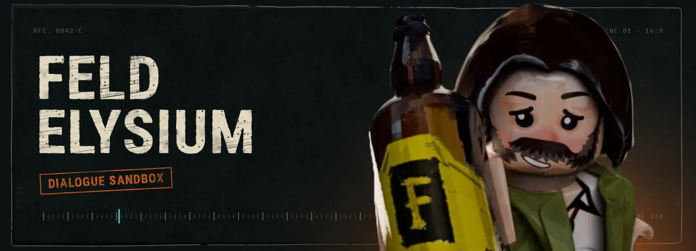
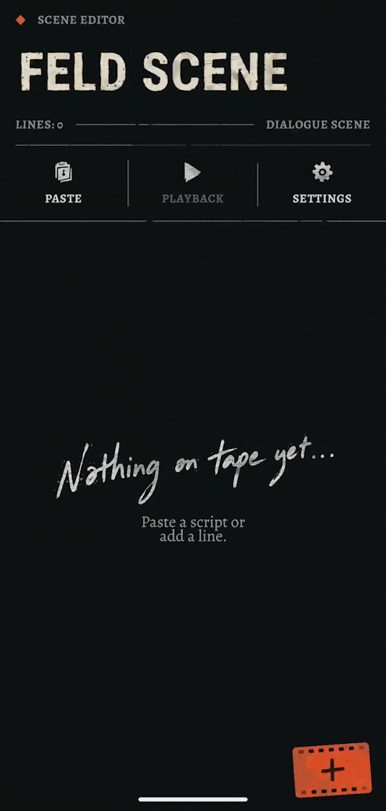
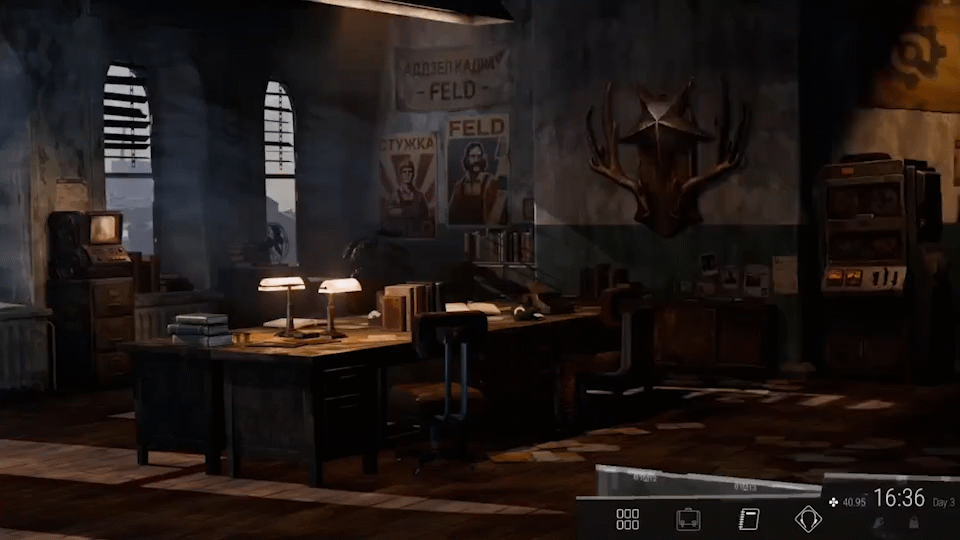
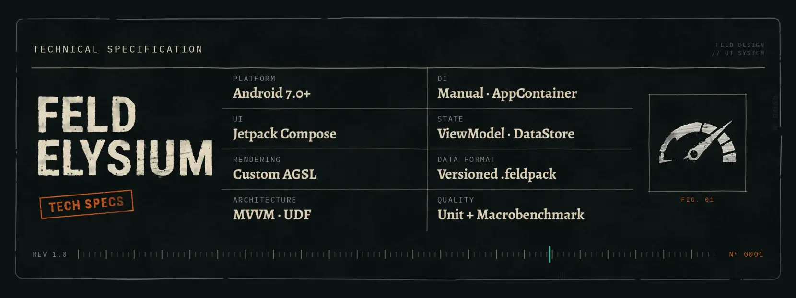
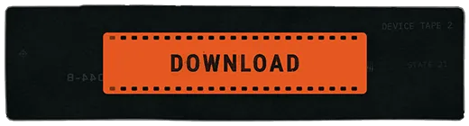

<p align="center">
  
</p>
<p align="center">
  <a href="https://github.com/dasdasr/FeldElysium/actions"></a>
  <a href="https://github.com/dasdasr/FeldElysium/releases/latest"></a>
  
  <a href="LICENSE"></a>
</p>

<p align="center">
  <a href="https://github.com/dasdasr/FeldElysium/releases/latest"><b>Download</b></a> &nbsp;/&nbsp;
  <a href="#install">Install</a> &nbsp;/&nbsp;
  <a href="#what-it-does">What it does</a> &nbsp;/&nbsp;
  <a href="#under-the-hood">Under the hood</a> &nbsp;/&nbsp;
  <a href="#engineering">Engineering</a> &nbsp;/&nbsp;
  <a href="https://github.com/dasdasr/feld-design">Design system</a>
</p>

<p align="center">
  Write your own speakers, build scenes, add skill checks and damage,<br>
  then play it all back full screen. No account, no ads. Android 7.0+.
</p>

> [!NOTE]
> A sandbox tool. Not affiliated with ZA/UM.

<table align="center">
  <tr>
    <td width="270">
      
    </td>
    <td width="480">
      
    </td>
  </tr>
  <tr>
    <td align="center"><sub>BUILD IT</sub></td>
    <td align="center"><sub>PLAY IT</sub></td>
  </tr>
</table>

## Install

1. Open [Releases](https://github.com/dasdasr/FeldElysium/releases/latest) and download the `.apk`.
2. Open it on your phone and allow installs from this source when Android asks.

The `.aab` in the same release is the Play Store bundle. It can't be installed directly, you don't
need it.

## What it does

- **Your own cast.** Speakers with custom portraits, colors and tags.
- **Scenes.** Write lines by hand or paste a script and let the importer split it.
- **Checks and damage.** Passive and active skill checks, health and morale damage, shown the way
  the game shows them.
- **Playback.** Full screen 16:9, your background (image, video, color) and font. Optional screen
  recording.
- **Portable.** Speakers export as one ZIP, scenes export and import too.
- **Ten languages.**

## Under the hood

Kotlin, Jetpack Compose, ViewModels with unidirectional state, DataStore.
Dependency injection is handled manually through `AppContainer`.

The paper, tape and ink look is rendered by custom AGSL shaders, which are expensive in Compose.
Each surface is rendered once into a bitmap and cached (LRU, size-capped, trimmed on memory
pressure), and shaders are compiled at launch. Below API 33 the same layouts fall back to flat,
shader-free drawing.

<p align="center">
  
</p>

**Where design lives.** The shaders and components were extracted into a separate library,
[**feld-design**](https://github.com/dasdasr/feld-design) (published on JitPack). If the look is
what interests you, start there.
Banner and spec images in this README are rendered with it.

### Performance

Macrobenchmark on Pixel 9 Pro, baseline numbers:

| Benchmark                        | Result                    |
|----------------------------------|---------------------------|
| Cold start (no compilation)      | TTID 875 ms               |
| Cold start (partial, no profile) | TTID 651 ms               |
| Editor scroll, 80 entries        | frame overrun P99 25.1 ms |
| Playback                         | frame overrun P99 64.8 ms |

Playback and navigation still stutter. Next: Baseline Profile and re-measuring. Full history and
conditions: [RESULTS.md](benchmark/src/main/java/com/feldelysium/benchmark/RESULTS.md).

## Engineering

- **CI:** GitHub Actions on push and PR (Detekt, Android Lint, unit tests, debug build).
- **Releases:** tag `v*` builds signed APK and AAB, keeps `mapping.txt`, publishes a GitHub Release.
  Older builds stay in [Releases](https://github.com/dasdasr/FeldElysium/releases).
- **Release build:** R8 and resource shrinking, custom keep rules.
- **Tests:** unit tests for core logic (bulk-import parser, playback engine, playback ViewModel,
  speaker reconciliation).

## Build

```bash
./gradlew assembleDebug        # debug APK, no signing keys needed
./gradlew detekt lintDebug testDebugUnitTest   # same checks as CI
./gradlew :app:connectedBenchmark1AndroidTest  # benchmarks, device required
```

Release builds need your own signing config.

<p align="center">
  <a href="https://github.com/dasdasr/FeldElysium/releases/latest">
    
  </a>
</p>

<sub><a href="LICENSE">MIT License</a> · <a href="NOTICE.md">Notice</a></sub>
